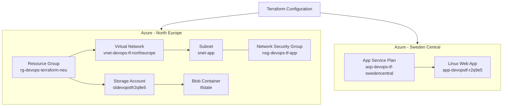

# Project 4 – Azure Infrastructure Automation with Terraform

## Project goal

This project demonstrates infrastructure as code using Terraform on Microsoft Azure.  
It automates the creation of a resource group, virtual network, subnet, network security group, storage account, remote Terraform state container, App Service Plan and Linux Web App.

The networking and storage resources are deployed in **North Europe**, while the App Service Plan and Web App are deployed in **Sweden Central** because of regional capacity restrictions.

## Technologies used

- Terraform
- Microsoft Azure
- Azure Virtual Network
- Azure Network Security Group
- Azure Storage Account
- Azure App Service
- GitHub

## Architecture



The App Service is deployed as a separate Azure resource. In this project it is not integrated into the virtual network.

## Terraform commands

```bash
terraform init
terraform fmt
terraform validate
terraform plan
terraform apply
terraform output
```

## Deployment result

```text
Apply complete! Resources: 2 added, 0 changed, 0 destroyed.
```

## Terraform outputs

```text
app_service_plan_name = "asp-devops-tf-swedencentral"
network_security_group_name = "nsg-devops-tf-app"
resource_group_location = "northeurope"
resource_group_name = "rg-devops-terraform-neu"
storage_account_name = "stdevopstfr2q9e5"
subnet_name = "snet-app"
terraform_state_container_name = "tfstate"
virtual_network_name = "vnet-devops-tf-northeurope"
web_app_name = "app-devopstf-r2q9e5"
web_app_url = "[https://app-devopstf-r2q9e5.azurewebsites.net](https://app-devopstf-r2q9e5.azurewebsites.net)"
```

## What I learned

- Creating Azure resources with Terraform.
- Using Terraform state stored remotely in Azure Blob Storage.
- Configuring virtual networking and network security rules.
- Deploying an Azure App Service Plan and Linux Web App.
- Handling Azure regional capacity and quota limitations.
- Reviewing Terraform plans before applying infrastructure changes.